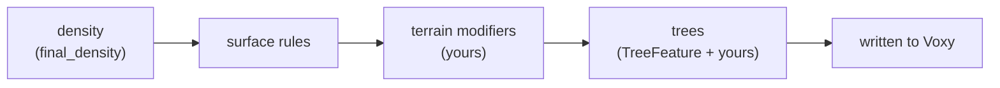

# Seed LOD API for world generation mods

Seed LOD draws distant terrain by running a dimension's world generation itself, at a coarse grid, without
generating chunks. It can only draw what it can see. This page is for mod authors whose terrain or trees would
otherwise be missing or wrong in the distance.

## Do you need it?

Most worldgen mods need nothing. Seed LOD reads these straight from the registries, so whatever a data pack or mod
puts there shows up on its own:

- noise settings and density functions (`final_density`), including custom density function types
- surface rules
- the biome source and biomes
- each biome's placed features, and any vanilla `TreeFeature` among them (counts, placement, shape, blocks)

You need the API when your mod changes worldgen somewhere else:

| Your mod...                                                                 | Use                                   |
| --------------------------------------------------------------------------- | ------------------------------------- |
| changes terrain in code: a mixin into a chunk status, carving after noise    | [terrain modifier](#terrain-modifiers) |
| grows trees with its own `Feature` class instead of `TreeFeature`            | [tree feature](#tree-features)         |
| has features or mixins that break, or must behave differently, in Seed LOD   | [`SeedLodApi`](#detecting-seed-lod)    |

## Where your code runs



Seed LOD generates square areas at five levels of detail. At level 0 a voxel is one block; at level 4 it is a
16-block cube. Near the player, areas are level 0 to 2 and trees are grown by running their real features. Further
out, levels 3 and 4 draw tree canopy from an average shape instead.

## Setup

Seed LOD isn't on a Maven repository. Copy its jar into your project and compile against it without bundling it:

```groovy
dependencies {
    compileOnly files("libs/seedlod-<version>.jar")
}
```

Write a plugin and list it under the `seedlod` entrypoint in your `fabric.mod.json`:

```json
"entrypoints": {
  "seedlod": ["com.example.rivers.compat.RiversSeedLod"]
}
```

```java
public final class RiversSeedLod implements SeedLodPlugin {
    @Override
    public void register(SeedLodRegistrar registrar) {
        registrar.terrainModifier(Identifier.fromNamespaceAndPath("rivers", "channels"), RiverCarver::new);
    }
}
```

Fabric only loads entrypoint classes for mods that ask for them, so this class is never touched when Seed LOD is
missing. Your mod doesn't need to depend on Seed LOD. Keep every reference to `dev.winter.seedlod.api` inside
classes that only the plugin reaches.

`register` is called once, the first time Seed LOD generates anything. By then every mod has initialized. It may
run on a background thread. If it throws, Seed LOD logs the error and drops everything that plugin registered.

## Terrain modifiers

A terrain modifier edits each generated area after the surface rules and before trees, so trees grow on the
edited ground. It's the place for terrain your mod makes in code rather than through density functions or surface
rules.

```java
public final class RiverCarver implements TerrainModifier {
    private final RiverNetwork rivers;

    /** One per generator thread and dimension; see "Threads" below. */
    public RiverCarver(WorldgenContext world) {
        this.rivers = new RiverNetwork(world.seed());
    }

    @Override
    public void modify(TerrainArea area) {
        int step = area.step(), half = step / 2;
        BlockState water = Blocks.WATER.defaultBlockState();
        for (int z = area.minZ(); z < area.maxZ(); z += step)
            for (int x = area.minX(); x < area.maxX(); x += step) {
                // Sample at the voxel's centre.
                int bed = this.rivers.bedHeight(x + half, z + half);
                if (bed == RiverNetwork.NONE) continue;
                int top = area.height(Heightmap.Types.WORLD_SURFACE_WG, x, z);
                int surface = this.rivers.waterLevel(x + half, z + half);
                for (int y = area.minY(); y < top; y += step) {
                    if (y >= bed) area.setBlock(x, y, z, y < surface ? water : Blocks.AIR.defaultBlockState());
                }
            }
    }
}
```

You register a `TerrainModifier.Factory`, not a modifier. The factory gets a `WorldgenContext` (the dimension, seed,
`RandomState`, noise settings, generator, registries, height range, sea level) and returns the modifier for that
dimension, or `null` to skip the dimension:

```java
registrar.terrainModifier(id, world -> world.dimension() == Level.OVERWORLD ? new RiverCarver(world) : null);
```

### The area

`TerrainArea` uses block coordinates throughout. Each call reads or writes the voxel that holds that block, so at
level 3 `setBlock(x, y, z, …)` fills an 8×8×8 cube. Step through the area one voxel at a time with `step()`, and
sample your own functions at voxel centres (`x + step / 2`).

| Method                    | Gives                                                                         |
| ------------------------- | ----------------------------------------------------------------------------- |
| `level()`, `step()`       | level of detail (0–4) and blocks per voxel edge (`1 << level`)                |
| `minX/maxX`, `minZ/maxZ`  | blocks covered, max exclusive                                                 |
| `minY/maxY`               | the voxels' height range; can reach a little past the dimension's own         |
| `getBlock`, `setBlock`    | a voxel's block; air outside the area, writes outside it are ignored          |
| `height(type, x, z)`      | like a chunk heightmap: the bottom of the voxel above the highest one `type` counts |
| `surfaceBiome(x, z)`      | the column's surface biome                                                    |

After all modifiers run, Seed LOD relights the columns you changed: air gets full skylight, and fluid darkens with
depth below its surface.

### Rules

- **Depend on position only.** An edit at a block must depend on that block's position and the world, never on
  the area's bounds. Areas overlap at their edges, and the same ground is generated again at every level. An edit
  that follows the area's edges shows seams.
- **Work at the area's level.** At level 4 one voxel is 4,096 blocks. Sample once per voxel, not once per block.
  Your modifier runs for every area at every level, so its cost adds straight to generation time.
- **Threads.** Generator threads run in parallel. Each one calls your factory once per dimension and keeps the
  modifier it gets, so a modifier is only ever used by one thread. Caches on the modifier need no locks. Anything
  shared between modifiers (a static cache, a shared `RiverNetwork`) must be thread-safe.
- **Determinism.** Read only the seed and the registries, which the server and its clients both have.
  `world.level()` is the live `ServerLevel` in singleplayer and on the server, and `null` on a client connected to
  a server. See [Servers](#servers-and-clients).

If your modifier throws, Seed LOD logs it once and carries on with the rest of the area unchanged by it. If your
factory throws, the modifier is left out for that dimension.

Modifiers run in order of id. That keeps the order the same on the server and its clients, whatever order the
mods loaded in.

## Tree features

Seed LOD grows trees from each biome's vegetation step. It recognises vanilla's `TreeFeature` and
`FallenTreeFeature`. If your mod grows trees with its own `Feature` class, register that class:

```java
registrar.treeFeature(PalmTreeFeature.class, (palm, random) -> new TreeShape.Canopy(
    palm.height().sample(random) + 2,  // height: ground to the top of the crown
    3.5F,                              // crownRadius: reach from the trunk
    3,                                 // crownHeight: bottom of the crown to its top
    palm.leaves().getState(null, random, BlockPos.ZERO)));
```

A registered class (and its subclasses) is then handled at both distances:

- **Near (levels 0–2):** Seed LOD runs your feature, with the same seeds vanilla's decoration gives it, against
  its own level. Trees come out where real chunks will have them. See below for what that level can do.
- **Far (levels 3–4):** Seed LOD doesn't run features here. It scatters as many crowns per chunk as the biome's
  placement modifiers give (count, rarity, noise counts), each the shape your `TreeShape` returns. The shape is
  asked once per configured feature and cached, so average over `random` if your feature varies. Return `null` for
  a feature that doesn't show from afar.

A shape registered for a class wins over Seed LOD's own reading. That includes `TreeFeature`, so you can correct
how vanilla-type trees from your data pack look in the distance.

### The level features run in

Near trees are placed in a stand-in `WorldGenLevel` that holds the generated voxels and nothing else. It supports:

- `getBlockState`, `getFluidState`, `isStateAtPosition`, `isFluidAtPosition`, `setBlock`, `removeBlock`,
  `destroyBlock`, `ensureCanWrite`
- `getHeight(Heightmap.Types, x, z)`, `getHeight()`, `getMinY()`, `getSeaLevel()`
- `getBiome(pos)`, `getSeed()`, `getRandom()`, `registryAccess()`, `isClientSide()` (false)
- light: `getBrightness` and `getRawBrightness` report open sky and no block light; `canSeeSky` is always true
- `getBlockEntity` returns null. Block updates, scheduled ticks, game events, sounds and particles do nothing.
- `getLevel()` returns the live `ServerLevel` when there is one. On a client connected to a server it throws.
- any default method of the interfaces built on the above

Anything else throws `UnsupportedOperationException`. Seed LOD then skips that feature at that spot and logs it
once. Above level 0 a block stands for a whole voxel. Writing air there does nothing, and a log replaces leaves but
nothing else replaces an existing block, the way Voxy's own coarse levels show real trees.

## Detecting Seed LOD

`SeedLodApi` is for code that runs inside Seed LOD's generation without registering anything: your features, and
mixins into worldgen.

```java
// In a feature: skip server-only work in Seed LOD's level.
if (FabricLoader.getInstance().isModLoaded("seedlod") && SeedLodCompat.isSeedLodLevel(level)) return true;
```

```java
// SeedLodCompat.java: the only class that references Seed LOD, so it loads only when Seed LOD is there.
final class SeedLodCompat {
    static boolean isSeedLodLevel(LevelReader level) {
        return SeedLodApi.isSeedLodLevel(level);
    }

    /** Whether this thread is generating Seed LOD terrain on a client with no server level to ask. */
    static boolean generatingWithoutLevel() {
        WorldgenContext world = SeedLodApi.current();
        return world != null && world.level() == null;
    }
}
```

- `isSeedLodLevel(level)` is true for the level near trees are placed in.
- `current()` returns the world being generated while this thread generates Seed LOD terrain (terrain, modifiers,
  trees), and `null` otherwise. Use it where no level is passed in, such as a static config check reached from a
  feature.

## Servers and clients

On a server, Seed LOD runs on each client. The server sends the seed, its enabled data packs, each dimension's
generator and each biome's feature list. The client rebuilds the worldgen from its own mods and generates a test
area. It compares that with the same area generated on the server, and only starts if they match.

Your plugin is part of that test area: terrain modifiers run in it, trees don't. So:

- Install your mod on both the server and the client. If only the server has it, the areas differ and the client
  doesn't start, rather than drawing terrain that doesn't match.
- A modifier must give the same result with and without `world.level()`. If it can't, return `null` from the
  factory when `world.level()` is `null`. The test still fails, but the cause is clear.
- Config that changes terrain must match too. Sync it, or keep it on the server.

The client logs which part of the test differed (`shape`, `surface` or `biomes`). Seed LOD logs what plugins
registered, on both sides, as `Seed LOD hooks: terrain modifiers [...], tree features [...]`, so the two logs can
be compared.

## Saved data

Seed LOD remembers which areas it has generated, per world, and doesn't redo them. After you change what your
plugin generates, run `/seedlod regen` in game to generate everything again.
